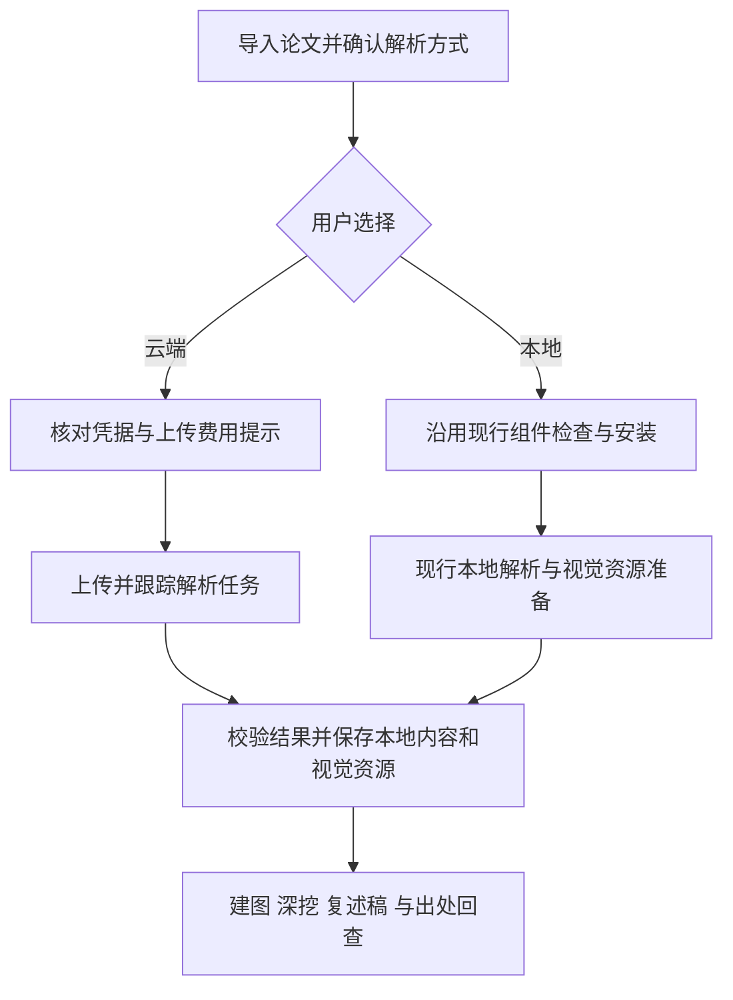
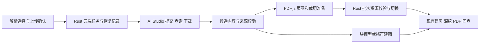
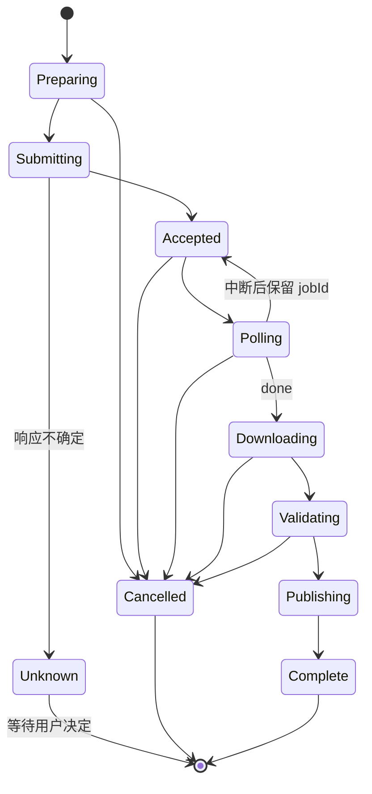
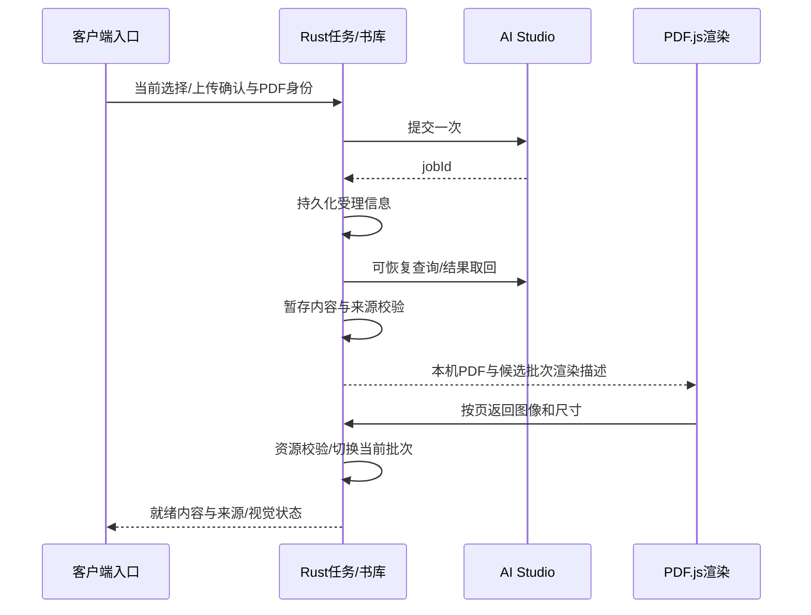

# 百度云端论文解析完整链路 - Plan

## Goal Capsule

- **Objective:** 用户可以选择百度云端解析论文，完成入库、精读与可信出处回查，已保存的原文和视觉资源可离线查看；现行本地解析仍可选择。
- **Product authority:** 本文承接用户确认的 v1.4.0 范围，以 [STRATEGY.md](../../STRATEGY.md)、[CONCEPTS.md](../../CONCEPTS.md) 的论文精读与本地书库语义为基础；云端上传是用户主动选择的新增行为。
- **Open blockers:** 离线结果适配与客户端实施可开始；新增真实调用需要本机可用凭据，产品来源、离线资源与专项仍须验收。用户已要求继续完成百度链路，不再以已知局部质量误差阻止开工。
- **Stop condition:** 缺页、无法验证页序或坐标、视觉资源无法离线使用、替换失败破坏旧结果或旧出处误绑新内容时停止发布候选结果，保留旧版本并报告原因。

---

## Product Contract

### Summary

本计划交付百度 AI Studio PaddleOCR-VL 云端解析的完整客户端链路，保留现行本地解析选择。用户于 2026-10-06 明确将本地组件调整移到 [后续需求计划](2026-10-06-1436-feat-local-parser-components-plan.md)。解析方式不同，后续建图、深挖、复述稿与出处回查仍使用一致的领域语义。

Product Contract 已改动：R1 收敛为云端交付与现行本地兼容；R10-R13、R16 及 F3/F4、AE3-AE5 移至后续计划，保留编号追溯；R8 的局部误差评估允许开发推进，发布仍须通过本文验收。来源为本轮用户明确范围修订。

### Problem Frame

用户反馈侧车组件包过大，同时希望使用国内云端 OCR 或多模态模型作为本地解析的替代方式。当前发行清单记录完整组件 ZIP 为 885,407,140 字节，展开为 1,668,938,420 字节；这只是发布元数据，不是本轮重测结果。

现行组件将嵌入式 Python、运行依赖和基础模型整套交付，普通文本论文也要求全套基础模型就绪；其瘦身收益由后续计划测量。当前云端成果须覆盖结构化文本和视觉证据，不能只返回 Markdown 而让用户继续安装完整侧车。

### Key Decisions

- **本计划只交付百度云端新增能力，现行本地路径保持兼容。** Governs R1, R7. (session-settled: user-directed — 2026-10-06 用户将本地组件调整移至后续计划，本计划剩余工作为百度完整链路。)
- **云端首版只接入一家通过论文对照的国内服务。** Governs R7, R8. (session-settled: user-directed — chosen over integrating three vendors or generic multimodal endpoints immediately: validate one route before expanding.)
- **用户配置默认方式，导入时可改单篇选择，自行提供凭据并承担服务费用。** Governs R2, R3, R4. (session-settled: user-approved — chosen over automatic routing and shared credentials: preserve user control over upload and cost.)
- **失败由用户选择重试或改用本地。** Governs R5, R6. (session-settled: user-approved — chosen over automatic resubmission or fallback: avoid unexpected upload and repeated billing.)
- **本地基础解析瘦身与按需能力另行实施。** Governs deferred R10-R13, R16. (session-settled: user-directed — 2026-10-06 范围调整；不作为本计划完成或开工条件。)
- **切换方式不自动改写存量论文，云端结果完成后可离线查看。** Governs R7, R9, R14. (session-settled: user-approved — chosen over automatic reprocessing or dependence on the full local component: retain existing content and make cloud parsing independently useful.)

### Requirements

**选择、上传与任务**

- R1. 用户可选择百度云端解析或现行本地解析组件；本计划交付实际可用云端链路，保持已有本地行为兼容，服务试验报告不能替代客户端交付。
- R2. 设置中保存默认解析方式，导入 PDF、arXiv 论文及示例论文时可在解析启动前更改单篇选择；未作选择的新用户须先选择，不能因默认值而静默上传。
- R3. 云端解析使用用户自行配置的服务凭据，费用由用户承担；凭据只存本机设置，不进入论文导出、日志或可分享的结果。
- R4. 云端启动前明确告知论文或页面图像将发送到所选服务，并提示可能计费；提醒可随配置确认持续生效，实际发送须与当前单篇选择一致。
- R5. 云端任务显示实际阶段、成功或失败及可理解的原因；失败可由用户重试或明确改用本地，不自动重提可能计费的解析请求或自动切换服务。
- R6. 取消须停止客户端后续提交和结果发布，释放本机任务准入；已经受理的远端任务可能继续执行或计费时如实提示，不能承诺供应商无法保证的撤销。中断后同一已受理任务的状态查询、结果取回与重新提交须区分，避免将查询恢复变成重复付费解析。

**云端结果与阅读契约**

- R7. 云端首版接入一家国内服务，未安装完整本地组件时仍可完成解析与所需视觉资源准备，并进入建图、深挖和出处回查。
- R8. 使用同一真实论文集与现行本地方案对照，验证章节和阅读顺序、文本完整性、公式与表格数字、图表及标题归属、页完整性及 PDF 坐标。现有 49 页对照可作为开发依据，已知局部内容误差保留记录，不承诺自动检测所有错误；公式和表格必须能回看对应原 PDF 区域。缺页、系统性错序或错误定位不得发布为成功，专项与产品集成验收通过后才正式交付。
- R9. 云端解析的结构化结果、必要页图和图表资源保存到本地书库，断网后仍可查看已保存内容和出处；供应商临时链接不可作为唯一资源来源。模型生成行为仍需要已配置模型服务，不承诺断网生成。

**后续计划的编号保留**

- R10-R13. 本地基础解析、扩展能力、安装及兼容需求已移至 [后续需求计划](2026-10-06-1436-feat-local-parser-components-plan.md)，不计本计划验收。

**存量兼容与收益**

- R14. 更改默认方式只影响后续任务，已解析论文继续使用已有结果；明确发起重解析时才采用所选方式。失败或取消不得破坏旧结果，成功替换须处理依赖旧块地址的阅读产物、问答绑定及出处，不能让旧地址指向新内容；具体失效和用户提示规则在规划前核对现行重解析路径，若需新的破坏性行为则返回对齐。
- R15. 两种方式均遵循现有文本块、图表、页码及可信出处语义；无法核实的区域只能给出页级定位或明确降级，不把模型猜测坐标当成精确命中。
- R16. 本地组件实测收益移至上述后续计划，不计本计划验收。

### Key Flows

- F1. **Trigger:** 用户首次配置。**Steps:** 选择方式，云端配置凭据并了解上传与费用，本地沿用现行组件入口。**Outcome:** 后续导入有明确默认值，单篇仍可修改，满足 R2-R4。
- F2. **Trigger:** 用户选择云端导入。**Steps:** 核对配置，提交后跟踪任务，取回并核实所有所需结果，保存到本机。**Outcome:** 无完整侧车也能阅读和取证，后续不依赖临时链接，满足 R5-R9。
- F3/F4. 本地基础与按需能力流程移至后续计划，同编号保留。
- F5. **Trigger:** 切换默认方式或明确重解析。**Steps:** 按 R14 保留既有结果，核对替换影响，再发布新结果。**Outcome:** 切换不隐式改库，旧出处不误绑新内容。

### Acceptance Examples

- AE1. **Covers R2-R4, R7, R9.** 新安装且未装完整组件的用户选择云端，只有完成配置与上传提示后才发送论文；成功后关闭网络仍能查看原文、图表和出处。
- AE2. **Covers R5, R6.** 云端提交已受理但查询断线，重试查询不再次提交解析；取消后本机任务可结束，若远端无法停止则明确提示可能继续计费。
- AE3-AE5. 本地基础与安装验收移至后续计划，同编号保留。
- AE6. **Covers R14, R15.** 已有本地解析论文切换默认为云端后，旧产物及出处不变；明确重解析失败仍可读旧结果，成功后的旧绑定不得误命中新块。
- AE7. **Covers R8, R15.** 双栏、密集表格、公式、跨页图表和扫描页论文逐项对照；某云端结果只有流畅文字但缺页或数字错误，不能因 Markdown 可显示就通过。

### Scope Boundaries

- 云端首版不同时承诺百度、火山和阿里多家适配，也不承诺任意多模态接口都能用于解析；后续接入须经过同样的证据验证。
- 本次不建立托管账户、共享 API Key、模型代理、云同步或 Android 客户端；论文内容权威来源仍是 Windows 本地书库。
- 本地组件拆包、依赖裁剪、模型组合、按需能力及首次可用收益均属后续计划。本计划仍负责云端专用的页图与裁切准备，以满足 R7/R9；这不修改本地组件包或发版格式。
- 不改造阅读工作台，不重新设计建图、深挖和复述稿；为解析后端兼容而调整共有契约时保持这些行为。

<!-- nk-section: work-relationships -->
### How This Work Fits Together

本 Plan 覆盖百度云端完整链路与现行本地兼容。后续组件计划复用本计划形成的结果、来源、视觉资源与任务边界，不作为本计划依赖。

- **以 v1.3.0 正式版复核：** 本分支最初从 `be4dedf` 开始，暂停期间等待的 v1.3.0 已正式发布。2026-10-06 用户决定在主目录恢复 v1.4.0，本分支整合最新 `main`（`477331d`）。须先对照现行 PDF 与原文块映射、文字坐标及侧车实现复核本 Plan，再补全实验和实施安排。
- **共享出处语义：** 本分支已包含 v1.3.0 PDF 证据阅读成果；后续仍须补做云端和本地解析结果的 PDF 回归，已有阅读验收不能代替新增解析路径验收。
- **后续扩展：** 更多云端服务及替代本地后端另行决定，本 Plan 不承诺完整路线图。

### Outstanding Questions

服务已选 AI Studio，接口及既有真实结果可复用。实现时验证账号限额、结果资源有效性和取消能力；不假定免费额度或永久资源 URL。首次新调用前读取用户本机配置，不从聊天或仓库恢复 Token。远端保存/删除行为尚未核实，客户端只承诺本机清理与停止后续请求。

## Planning Contract

### Key Technical Decisions

- **KTD1：Rust 调用 AI Studio 异步任务。** 固定首版服务与模型，复用 `tools/parser-pilot/aistudio.py` 的真实协议证据，在 Rust 实现提交/查询/取回，不调用 Python 试点脚本作为生产网络后端。请求沿用 `net.rs` 的自动代理/直连设置；Token 使用现行本机设置模式，独立于 LLM 凭据，前端遮罩、不回显到任务结果，导出/日志/错误均脱敏。首版不声称加密存储，不新增通用厂商框架。
- **KTD2：受理任务可恢复，提交不自动重传。** 请求前持久化本机任务意图，受理后保存 jobId、原 PDF 摘要、参数和批次。状态为准备、提交中、受理、查询中、下载中、校验中、发布中、完成/失败/取消；提交响应不确定进入“受理状态未知”，由用户明确重新提交。默认 5 秒查询，单轮等待 900 秒后保留可恢复状态，不当成远端取消。下载断线可重新取回同任务，401/403 提示配置，429 显示限额原因；不重新上传。取消与同篇任务准入覆盖网络、渲染、发布全程。
- **KTD3：转换内容并建立独立云端来源证据。** 复用现行块模型及 `SourceRegion`，云端原始结果保留 provider/model/参数与摘要；新来源附件绑定原 PDF SHA-256、本次块模型投影 SHA-256 和批次，不伪装为 Docling。Rust 来源恢复保留旧 Docling 分支，返回前重查当前文件摘要。同组文本保留全部框；空续框不新造空段落。绝对页序须核对 PDF 页数、结果完整性与输出批次顺序，重复/缺页不得成功；字符区间只有真实依据才写。
- **KTD4：云端视觉资源使用现有 PDF.js 独立准备。** 复用 `pdf-selection.js`、`pdf-reader.js` 的 PDF.js 渲染能力，增加顺序分页的页图/裁切准备，将必要资源提交至 Rust 候选批次；不经过现行 Docling 重映射或完整组件门禁。保持建图只要求块模型就绪、深挖要求所需视觉资产齐备的语义。重启后可继续未完成资源准备；不能因 WebView 关闭而宣称全部齐备。供应商图像仅作补充，外链取回受 HTTPS、域名、大小及重定向约束，Token 只发官方任务端点，不随资源请求转发。
- **KTD5：候选批次校验后安全切换。** 云端新增结果及视觉资产按批次暂存，附件摘要和所需资产校验后由 Rust 切换当前结果引用，读者只读完整同一批次；失败、取消、崩溃或迟到回调不覆盖旧结果。首次导入块模型可先就绪，视觉状态单独标记，深挖按齐备性等待；重解析则保留旧当前批次，直到新批次满足替换条件。同篇解析与依赖旧结果的生成任务互斥，重启恢复提交标记，清理只处理未引用候选。
- **KTD6：历史内容保留，旧绑定不映射到新块。** 重解析成功保留实际选中文字、截图和聊天文本，按解析批次隔离块 ID；旧 hits/cite/章节绑定标为旧结果来源，不通过字符串巧合绑定新块。旧批次及相关附件保留供历史回看，不在本单元自动清除；现行论文级 map/retell 等已生成内容保留并标注来源版本，不能算新结果的已完成产物。替换前提示这些影响，不删除历史。若现有 schema 无法表达版本隔离，U6 补兼容迁移，不能先覆盖后修绑定。

### Geometry & Visual Boundaries

来源页号为 1 起始，bbox 为左上角 scale=2 的 `[x,y,width,height]`，pageSize 为 scale=1 的 PDF 页尺寸。AI Studio XYXY 根据实际输出图尺寸和原 PDF 尺寸转换；预处理导致几何变换、尺寸不符、旋转无法校准或越界时只给页级定位。PDF.js 渲染元数据与云端声明须分开，Rust 检查页号、尺寸、框范围、文件/结果摘要；不信任未经绑定的前端坐标。公式/表格统一提供原图回看，不能只为已知错误块配置回看，也不承诺自动发现所有解析错误。

视觉证据保存分页面的区域列表。可信框分别裁切，跨页或同组多框不压成一个框；只有页号可信而几何无法校准时使用相关完整原页，标为页级视觉证据。资产清单与 JS/Rust 齐备检查按“裁切区域列表”或“完整页列表”判断；协议的 `get_figure`/公式取证读取所有关联资源，合法页级降级可以深挖，不伪造 bbox 或永远等待不存在的 crop。页序本身不可信则拒绝发布。

### Batch Read Contract

U4 开始前确定不可变批次 manifest 与逻辑附件解析契约，U4/U5 在候选批次空间写资源；U6 实现当前指针切换、旧数据迁移和崩溃恢复。一次阅读加载或协议任务固定 batchId，块模型、来源和全部图片按该批次读取；不得在取完模型后重新解析当前指针取图。旧固定附件映射为兼容批次，不要求重新解析。当前切换与历史来源版本状态一起提交，前端缓存按批次隔离。

导出导入须携带仍被阅读历史引用的批次 manifest、块模型、来源及视觉资产的完整依赖；不能只保存 batchId。实际 PDF 选区/截图仍按原身份保存；导入验证缺资源或错误摘要时明确降级旧解析出处，不能绑定到新当前批次。

### Assumptions & Deferred Implementation Details

- 用户要求继续完成云端链路，被承接为允许在记录已知局部内容误差、保留原图回看的边界下开发；不是总体质量或专项验收通过。原始试验结论保留在 Appendix。
- PDF.js 可承担云端路径的页图/裁切，依据现有截图渲染代码；U5 必须实测整篇内存、取消、窗口生命周期与恢复。若无法满足协议图像需求，在本计划内选择轻量渲染实现并复核依赖，不能静默依赖完整侧车或扩大为组件拆包。
- KTD5/KTD6 的批次读写接口与 manifest 在 U4 接线前确定；内部数据库字段与迁移版本由 U6 对照现行 library/schema 落实，批次读快照、安全发布及不删历史约束不推迟。
- reqwest 当前未启用 multipart feature；U3 选受控流式 multipart 或最小 feature 调整，避免将整篇大 PDF 多次复制进内存。具体文件/结果大小上限在 U3 依据现行导入限制明确并覆盖边界测试。
- 服务限额、结果过期、专项质量由 U7 实测；没有 Token 不阻止离线适配，但阻止真实联网验收。后续本地计划不参与这些依赖。

### High-Level Design

图中的提前建图仅适用于首次导入；显式重解析按 KTD5 保持旧批次直至替换可发布。

任一阶段失败均保留可诊断状态；提交未知没有自动回到 Submitting 的边。Publishing 前最后一次检查取消与批次身份，发布临界区通过 KTD5 保证切换一致；提交时取消须等待在途响应并记录是否受理，不丢弃可能取得的 jobId。

### System-Wide Impact & Risks

前端设置/导入、Rust 网络任务、书库附件、PDF 来源恢复和阅读协议均受影响。保持现有 `pdfmap.getSourceRegions@1` 的领域语义与旧 Docling 来源分支；新增解析批次元数据若需迁移，在 U6 覆盖旧 schema 与导出导入。前端缓存随当前批次切换失效，不让旧来源复用到新内容；生成任务必须携带所用批次，迟到结果不能混入新当前批次。

外部资源 URL 是输入信任边界：拒绝非 HTTPS、本地/私网目的地址、未允许的重定向与超大响应，按实际官方返回域名设置允许列表；供应商 HTML 只转安全结构化内容。上传确认与凭据变更保留明确用户选择。PDF.js 渲染占用通过逐页释放与取消控制；候选和历史批次带来额外磁盘成本，首版保留引用中的历史，不自动删附件换取占用数字。

## Implementation Units

保留 U1（本地基线）与 U2（真实对照）的历史含义和证据。原 U3 完整链路拆分：U3 保留云端任务核心，新分配 U4-U7，按 U3 → U4 → U5 → U6 → U7 顺序推进。进度由提交及 current 承接，不在此维护完成复选框。

### U3. 云端设置与可恢复解析任务

- **Goal / Requirements:** 设置默认方式与单篇选择，取得云端原始结果；R1-R6，F1/F2，AE2。
- **Dependencies:** U1/U2 的现有研究证据，无新的零错误质量前置条件。
- **Files:** `app/src-tauri/src/settings.rs`、`net.rs`、`tasks.rs`、`bridge.rs`、`lib.rs`，新增 `cloudparse.rs`；`app/ui/js/main.js` 的设置/导入入口；新增 `app/ui/js/cloud-parse.test.js` 与 `app/src-tauri/tests/cloudparse_jobs.rs`。
- **Approach:** 按 KTD1/KTD2 接线，用现行 bridge 任务、准入、网络模式及附件读写模式；已选本地不上传，旧用户不因新增默认值被改成云端。提交后参数与身份固定，配置变化只影响新任务。
- **Test scenarios:** 缺凭据与未确认不发送；PDF/arXiv/示例单篇选择一致；受理后断线/重启只查询；提交不确定不自动重传；401/429/超时原因可见；取消不发布；代理切换影响后续请求；日志/导出无 Token。Covers AE2。
- **Verification:** Rust 状态测试与 JS 流程测试通过，原生桥任务能读取脱敏进度和恢复记录；真实服务最晚在 U7 验收。

U3 的下载完成仅表示原始结果取回，不标记正文、来源或视觉资源已就绪；后续状态由 U4-U6 接入。

### U4. 百度结果转换与可信出处

- **Goal / Requirements:** 原始结果转换为现行块模型并可恢复合法来源；R7-R9、R15，AE7。
- **Dependencies:** U3。
- **Files:** 新增 `app/src-tauri/src/cloudparse_map.rs`；`pdfmap.rs`、`pdfmap_evidence.rs`、`bridge.rs`、`protocol.rs`、`library.rs` 的批次读取接口；新增脱敏 `app/src-tauri/tests/fixtures/aistudio/` 与 `cloudparse_mapping.rs` 测试；`app/ui/js/pdf-evidence.js` 及对应测试。
- **Approach:** 先落实 Batch Read Contract，再按 KTD3 与几何边界适配；复用块模型，不用 Markdown 扁平覆盖分组、表格或公式结构；HTML 转换按结构化解析且保持安全文本，不能直接执行供应商 HTML。测试夹具从现有原始结果裁选脱敏，不纳入凭据、临时资源 URL 或全文。
- **Test scenarios:** 分批页序、缺页/重复页、双栏、同组多框/空续框、表格/公式编号、错误 PDF/旧投影拒绝、TOPLEFT 尺寸缩放、旋转/预处理/越界页级降级；旧 Docling 来源仍可恢复。Covers AE7。
- **Verification:** 四篇既有结果离线映射，页完整性与关键内容锚点一致；原生桥恢复可信来源，在 PDF 原图叠加验证。不把已知内容错误静默纠正成“正确结果”。

### U5. 无完整组件的云端视觉准备

- **Goal / Requirements:** 生成并保存云端结果需要的页图、公式/表格/图形裁切，支持离线查看；R7/R9/R15，AE1。
- **Dependencies:** U4。
- **Files:** `app/ui/js/pdf-reader.js`、`pdf-selection.js`、`main.js`，新增 `cloud-pdf-assets.js` 与 `.test.js`；`app/src-tauri/src/pdfassets.rs`、`bridge.rs`、`protocol.rs`，新增 `app/src-tauri/tests/cloudparse_assets.rs`。
- **Approach:** KTD4，分页释放 canvas，资源以批次写入并校验；模型取证入口统一按能力/资产状态判断，不要求 `doclingJsonPath`。原图回看以本机 PDF 为依据，供应商可视化图不能冒充无标注原文。
- **Test scenarios:** 未装组件完成页图及可信区域裁切；旋转表格以完整页证据完成深挖、跨页/同组多框取到所有关联资源；纯文本/表格/公式深挖取得资源；断网重开可读；准备中取消/关闭窗口后恢复；大篇逐页释放内存；缺所选证据资源显示未齐备，不能继续视觉深挖。Covers AE1。
- **Verification:** 无完整侧车环境的 Tauri 窗口实测、资产身份/尺寸检查与离线回看通过，保留建图早启动语义。

### U6. 安全发布与重解析历史兼容

- **Goal / Requirements:** 首次与替换结果不混批次，旧结果及历史不误绑；R6/R14/R15，F5，AE6。
- **Dependencies:** U4/U5，使用 U3 任务准入。
- **Files:** `app/src-tauri/src/library.rs`、`migration.rs`、`pdfmap_evidence.rs`、`pdfassets.rs`、`cloudparse.rs`、`protocol.rs`；`app/ui/js/papers.js`、`main.js`、`pdf-selection.js`；新增 `app/src-tauri/tests/cloudparse_publish.rs` 及 `app/ui/js/parser-history.test.js`。
- **Approach:** KTD5/KTD6，候选校验/当前指针切换和恢复标记共同设计，沿用书库迁移及校验模式；云端到本地、现有本地到云端均覆盖。先补现行附件替换和历史绑定的特征测试，再落实版本隔离。
- **Test scenarios:** 下载/写来源/写图失败或取消旧结果仍可读；提交临界点崩溃恢复；迟到结果不发布；读取旧模型后切换当前批次，再取来源/图片仍属于旧读快照；旧截图/实际文字/聊天保存；旧 cite 不命中新块，旧来源可回看；导出导入携带完整历史依赖及无版本旧书库迁移；并行生成准入互斥。Covers AE6。
- **Verification:** 故障注入和重启回归证明读者不见混合批次，原生窗口重解析提示及历史重放通过，无历史自动删除。

### U7. 完整链路与专项验收

- **Goal / Requirements:** 同组真实论文与边界样本完成用户全流程；R1-R9/R14/R15，AE1/AE2/AE6/AE7。
- **Dependencies:** U3-U6。
- **Files:** `app/src-tauri/tests/fixtures/regression/`、新增云端专项夹具与测试；`tools/parser-pilot/README.md`、`app/README.md`、研究与 `docs/reviews/v1.4.0.md` 的验证记录。
- **Approach:** 复用已有四篇结果验证映射，新增真实调用仅为完整原生流程和专项所需；扫描、旋转/CropBox、跨页表格分别检验质量与来源降级。读取本机凭据，记录新增页数；不读取聊天 Token。服务暂不可用明确记录阻断，不将 mock 当供应商验收。
- **Test scenarios:** PDF/arXiv/示例导入→云端→建图→深挖→出处→重开；未装组件、断网、查询恢复、取消、重解析、导出导入；已知误差块始终可回看原文，非法几何不画精确框；本地路径回归。Covers AE1/AE2/AE6/AE7。
- **Verification:** 完成下文仓库检查和桌面 smoke，逐场景记录结果与未验项；遇到缺页、身份/来源错配或历史破坏停止交付。

## Verification Contract

按单元风险选择 JS、Rust 与原生窗口验证；最终执行仓库入口：`cd app` 后 `node --test`、`npm run smoke`；`cd app/src-tauri` 后 `cargo test`；根目录 `node tools/check_syntax.mjs`。JS 单测不替代 Tauri 桥、窗口和真实服务。单元提交须符合 AGENTS.md 的审查与 nk-commit 约定；GitHub CI 不可用时只记录本机结果，不标 CI 通过。

## Definition of Done

U3-U7 的行为与验证条件全部满足，百度为可选择的实际解析路径；原 PDF、块模型、可信来源和视觉资源可在本机一致恢复，断网可阅读已保存内容；未装完整组件仍可完成云端链路；旧本地解析及旧书库可用，重解析不损坏历史或错绑。已知解析误差保留说明，公式/表格可回看原图。后续本地组件计划不计入本计划完成条件。本轮规划文档交付不代表这些功能已实现。

## Appendix

以下保留既有试验和兼容复核的历史上下文。其中“U2 未通过、U3 不启动”“本地瘦身仍保留”均描述当时决定，已由本轮范围修订及上述 Planning Contract 取代；不能作为新会话的当前开工阻断。进度与首个单元以 current 为准。

### v1.3.0 兼容复核（2026-10-06）

Product Contract 未改动。以下补充落实 R5-R16 的技术边界与验收依据，不代表服务已选定或实施方案已补全。复核基点为 `main` 的 `477331d`，本目录在 `codex/v1.4.0` 继续推进；旧并行工作树已删除，需求提交仍保留在分支历史中。

1. **可信来源需要后端验证接线，不能只写入坐标。** `main.js` 的 `loadBlockModel` 读取块模型后先移除 `sourceRegions`，再通过 `pdfmap.getSourceRegions@1` 恢复。现行 `pdfmap_evidence.rs` 仅从 `docling-source.json` 或 Docling 缓存恢复，校验附件完整性、PDF 的 Docling 身份值与去除来源字段后的块模型投影，并在返回前重查 PDF / 块模型摘要。云端适配需提供与原始 PDF 和本次块模型绑定的可验证来源结果，保留现有旧 Docling 恢复路径；不得绕过 Rust 验证来让高亮可见。具体来源附件格式及验证方式留给实施规划，不能把云端坐标伪装成 Docling 输出。对应 R8、R9、R15。

2. **统一几何要写清单位、页尺寸和降级。** 当前 `SourceRegion` 使用 1 起始页码；`bbox` 为左上角原点、scale=2 的 `[x, y, width, height]`，`pageSize` 为 scale=1 的 PDF 页宽高，可选 `charspan` 为块内字符区间。多栏及跨页保留多个区域，不合成覆盖无关内容的大框。前端对页尺寸不匹配、越界或非零旋转不给精确矩形；云端坐标须完成转换和原始 PDF 叠加验证，不能在规划中承诺现行阅读器尚未支持的旋转高亮。对应 R8、R15。

3. **实际选区与解析出处分开兼容。** schema v8 已保存 `pdfSelection`，截图使用 `pdf-selection-*` 附件，支持历史重放与导出导入。`selectionBinding` 只在文字和唯一、连续来源块匹配时给出精确片段绑定；框选或不可靠命中只提供上下文。重解析须分别处理原 PDF 上的实际文字 / 截图、选区中的旧块命中、聊天片段引用和章节绑定；不能因为解析器改变就将实际截图等同于旧块数据删除，也不能让旧 `hits` / `cite` 命中新块。具体保留、失效和用户提示规则仍按 R14 对齐后决定。对应 R9、R14、R15。

4. **PDF 可显示不等于精读视觉资源就绪。** 连续阅读和选区截图已由 PDF.js 渲染，但 Rust 协议所需页图及图表 / 公式裁切仍走 `pdfassets.prerender@1`，需要侧车；`scope=all` 还会重映射 Docling 结果。前端 `ensureBlockModel` / `ensurePrerender` 也依赖本地解析就绪与 `doclingJsonPath`。云端方案必须覆盖这些前置入口、离线视觉附件和齐备性检查；不能只接入解析接口或看到 PDF.js 画面就宣称“无需完整组件”。本地瘦身测量须包含所选视觉资源生成依赖。对应 R7、R9、R10、R16。

5. **重解析需要安全发布边界。** `persist_convert_block_model` 先覆盖 `blockmodel.json`，再写 `docling-source.json`；预渲染附件逐件提交，`scope=all/crops` 还可能覆盖块模型。现有流程不是整套解析结果的原子替换。`papers.applyResplit` 是文本重新切分规则，会保留论文级 map / retell 及聊天，不能直接作为解析器切换的兼容政策。实施规划须先定义候选结果暂存、校验、取消检查、整套发布与旧产物处理，防止块模型、来源、页图和裁切来自不同解析批次；同篇已有建图、深挖或渲染任务时须处理竞争与迟到结果。对应 R6、R12、R14、R15。

6. **复用网络模式与任务准入，按云端提交语义重试。** v1.3.0 已有 Rust 自动代理 / 直连设置，新云端上传、查询与结果下载须遵循当前模式，尚未发送的后续请求重新读取模式，已发送请求沿原模式完成。Python 侧车不在此设置覆盖范围内。复用任务、组件与更新的统一准入边界，能力包下载沿用现有完整性及停流处理；云端计费提交不能直接套用通用网络自动重试，查询恢复与重新提交仍按 R5、R6 分开。新增网络阶段的超时阈值由实施规划确定，不直接把更新下载的阈值视作云端服务契约。对应 R5、R6、R12、R13。

**必须补入实施验证的场景**

| 场景 | 预期与追溯 |
| --- | --- |
| 云端双栏 / 跨页结果；错误 PDF 身份、旧块模型摘要、页尺寸不符、旋转页 | 合法来源经原生桥恢复并叠加；不可信来源保守降级，不猜画高亮。AE7、R15。 |
| 未装完整侧车，云端完成后断网并重开；再次建图或读取图表 | 原文、可信出处、页图及图表附件可用，准备入口不误要求 Docling。AE1、R7、R9。 |
| 本地与云端相互重解析；来源写入 / 裁切下载失败、取消或迟到任务 | 旧结果仍可读，不发布混合批次；成功后旧块引用不误绑新内容。AE6、R14。 |
| 重解析前已有文字选区、截图追问和片段聊天；重开及导出导入 | 实际文字 / 截图与历史问题对象保持一致，旧块绑定按明确兼容规则处理；旧聊天无选区字段仍可读。AE6、R9、R14。 |
| 云端任务已受理后查询断线、切换直连或取消；能力包停流后重试 | 不重复计费提交，后续请求使用当前网络模式，准入释放，已有本地能力不受破坏。AE2、AE5。 |

**复核结论与剩余决定**

两条解析路径与按需能力的产品方向仍适用，无需重做需求。实施规划应先确定共有的来源验证、视觉资源和安全发布契约，再落实云端适配及本地能力组合。服务真实质量、干净环境瘦身收益仍待实验；重解析后历史产物的具体处理尚未敲定，本轮不据此授权清空旧产物。v1.3.0 未更换解析组件，当前基线仍为 `1.2.0-beta.1`，原体积数字与现行清单一致，但不是新实测。

### 百度试点实施单元（2026-10-06）

用户选定百度 PaddleOCR-VL：先对照，效果通过后打通百度完整链路，为后续厂商提供经过验证的结果、来源、视觉资源和任务边界模板。首版不建立多厂商插件框架。本地瘦身仍保留在本 Plan，后续安排以实测为据。

| 单元 | 范围与完成条件 | 需求 |
| --- | --- | --- |
| U1：离线对照准备 | `tools/parser-pilot/`；运行现行组件，保存同机原始结果、身份与耗时；检查百度原始 JSON 并生成原 PDF 叠加图；统计不自动判通过。 | R8、R15；AE7 的准备工作 |
| U2：真实百度对照 | 取得本机凭据、上传及累计预算确认；记录参数与任务 ID，提交不自动重试，查询可恢复；保存真实原始输出并逐项人工评审。先跑 49 页文本层论文，再补扫描、旋转/CropBox、跨页表格专项样本。 | R5、R6、R8、R15；AE2、AE7 |
| U3：百度客户端完整链路 | 仅 U2 验证通过后补全并实施：Rust 上传/查询/下载、设置和单篇选择、可信来源恢复、无完整组件的视觉资源、离线查看、安全替换和历史绑定处理。原生桥、窗口、断网与取消回归必需。 | R1-R9、R14、R15；AE1、AE2、AE6 |

U1 使用 Adam、知识蒸馏、ResNet、XGBoost 现有公开论文夹具，共 49 页；不改 PDF，不把本地结果当成绝对真值。逐篇比对原 PDF 上的页完整性、标题/附录、双栏阅读顺序、关键公式及编号、表格数字与单元格、图表标题归属，以及段落/公式/表格/图形坐标。任何缺页、关键数字错误、系统性错序或错位均阻止 U3；局部降级须列举证据和影响后评估。全部判定保留人工记录，供应商宣传或模拟测试不算通过。

U1 已完成。2026-10-06 用户提供 AI Studio 的 PaddleOCR-VL-1.6 异步 API 示例及试点凭据，U2 改用 AI Studio 入口并实际上传同组 49 页，已完成提交/查询工具、原始结果取回、候选坐标叠加及全页人工核对。U2 尚未通过：确认 6 个局部问题块，可接受的误差与原图回看行为尚待明确，扫描与几何专项仍待完成。U3 的历史产物处理政策、来源附件格式和视觉生成实现仍未定稿；此增补不表示整个 Plan 已进入可执行状态。工具范围与命令见 [试点说明](../../tools/parser-pilot/README.md)。

**U1 同机证据（2026-10-06）**

使用已安装 `1.2.0-beta.1` bundled 组件（Docling 2.126.0），FAST、8 线程、公式增强关闭、独立进程。下列耗时为子进程启动到退出，不含叠加图生成，不是首次下载安装成本或服务端质量评分。

| 论文 | 页数 | 耗时（秒） | 结果 |
| --- | --- | --- | --- |
| Adam `1412.6980` | 15 | 44.69 | `ok:true`，无 warnings |
| 知识蒸馏 `1503.02531` | 9 | 87.53 | `ok:true`，无 warnings |
| ResNet `1512.03385` | 12 | 71.72 | `ok:true`，无 warnings |
| XGBoost `1603.02754` | 13 | 52.60 | `ok:true`，无 warnings |

原始产物和逐篇身份记录保留在本机 `tmp/parser-pilot-20261006/`，共生成 49 张叠加图。人工抽查 Adam 和 ResNet 首页，段落、标题与图形的框可与原 PDF 对照；未逐项完成整组内容质量评审。XGBoost 第 5 页一个文本区域因非法框保守降级，不能把所有框均可生成作为验收目标。百度尚未调用，扫描页、CropBox 与跨页表格专项未验证。

执行嵌入式 Python 的 `tools/parser-pilot/test_pilot.py`，9 项通过，覆盖几何拒绝、两种 Docling 原点、真实 PDF 旋转降级、防覆盖以及转换/检查失败状态；后者仅替代外部子进程边界，不是供应商质量验证。根目录 JavaScript 语法检查通过（137 个文件）。未修改产品代码，未运行 Rust / 桌面集成或 CI。

**U2 首轮结果（2026-10-06）**

试点请求固定 `PaddleOCR-VL-1.6`，通过 AI Studio Access Token 的 bearer 认证。原定百度智能云的 API Key / Secret Key、页价与 `pages[].layouts` 结构不适用于本轮，原格式检查器只保留为离线工具。实际结果通过 `prunedResult.parsing_res_list` 提供 XYXY 框、块内容、顺序及分组；JSONL 分批返回且没有绝对页号，页面对应关系仍需核验。

同组 PDF 身份值及 49 页数量一致，四任务均只提交一次，已取回结果、生成全部 49 页叠加图。简单表格和所查公式/正文具备可用结果，但 ResNet 第 5 页 Table 1 的 HTML 将 `152-layer` 设为跨 3 列，拆出额外数据列，使 `×8 / ×36` 与结构错挂；原 PDF 为 7 列。这触发 R8 / AE7 的质量停止条件，**U2 不判通过，U3 不启动**。候选框可生成不等于来源可信或内容正确。

具体样本、耗时口径、复杂表格、分组多框、页序及剩余检查见 [首轮实测报告](../research/2026-10-06-aistudio-pilot.md)。下一步先验证有证据支持的表格参数或明确视觉降级方案，再完成专项测试；不静默修饰服务输出，不将试验报告替代产品交付。

用户随后要求多个 `gpt-6-luna high` 全量核对，并表示若是偶发可以考虑接受。现有 49 页已逐页检查，确认 6 个局部问题块：两张表的结构/标签、两个附录公式/条件块，以及行内下标与最佳参数强调；未发现整段缺失或系统性栏序错乱。具体证据和统计口径见 [全量复核](../research/2026-10-06-aistudio-full-audit.md)。此次没有重新上传，不能证明随机偶发率；允许哪些局部误差及原图回看行为仍待明确，不能直接把 U2 改判为通过。产品级来源、视觉离线资源及扫描/旋转/CropBox/跨页专项仍未验收。

### Sources / Research

- 用户随后要求同标准核查 Docling。现行 FAST、关闭公式增强的同组 49 页已由三个 `gpt-6-luna high` 子代理全页核对，见 [Docling 全量对照](../research/2026-10-06-docling-full-audit.md)。当前配置并非零误差真值。用户在对照后要求本计划继续完成百度链路，按 R8 保留误差并落实原图回看，产品专项仍须验收。

- 本地实现：[组件清单](../../app/src-tauri/component-release.json)、[组件安装](../../app/src-tauri/src/component.rs)、[组件任务](../../app/src-tauri/src/component_runtime.rs)、[侧车门禁](../../app/src-tauri/src/pdfparse.rs)、[块模型映射](../../app/src-tauri/src/pdfmap.rs)、[侧车构建](../../tools/pdfparse-sidecar/build_sidecar.py)、[正式组件打包](../../tools/pdfparse-sidecar/package_component.py)和[侧车说明](../../tools/pdfparse-sidecar/README.md)。正式安装现行仅接受 bundled 整包；现有 download 构建变体不能直接当作新正式方案。
- v1.3.0 复核依据：[来源恢复](../../app/src-tauri/src/pdfmap_evidence.rs)、[前端读取与准备入口](../../app/ui/js/main.js)、[视觉资源落库](../../app/src-tauri/src/pdfassets.rs)、[选区绑定](../../app/ui/js/pdf-selection.js)、[书库校验](../../app/src-tauri/src/library.rs)、[重新切分](../../app/ui/js/papers.js)、[网络任务](../../app/src-tauri/src/net.rs) 与 [更新实现](../../app/src-tauri/src/updater.rs)。复用 [来源与选区契约](../solutions/architecture-patterns/pdf-provenance-and-selection.md) 和 [v1.3.0 发布边界](../releases/v1.3.0.md)，本轮仅核对源码与文档，未运行产品测试、云端调用或组件基准。
- 构想来源：[v2 构想](../ideation/2026-09-24-paper30min-v2-revision.md) 的「解析组件进一步瘦身」「替代解析后端」及试验门槛；整合 v1.3.0 后该文件已在本分支。
- 2026-09-30 核对的官方候选：百度[文档解析](https://ai.baidu.com/ai-doc/OCR/llxst5nn0)描述版面、阅读顺序和坐标；火山[智能文档解析](https://docs.volcengine.com/docs/Largemodelofimagegeneration/Callingmethod-2?lang=zh)描述逐页文本块、类别和坐标；阿里[文档智能大模型版](https://help.aliyun.com/zh/document-mind/developer-reference/document-parsing-large-model-version)描述本地文件上传、异步结果及版面坐标。均未在本轮实际调用。
- 百炼[文档解析提交](https://help.aliyun.com/zh/model-studio/parse/parse-submit)支持请求坐标，但所示接口要求文件 URL；本地 PDF 的上传路径和账号条件仍须验证。[Qwen-OCR](https://help.aliyun.com/zh/model-studio/qwen-vl-ocr)描述专用文档与文字定位任务，是候选而非已选后端。

## Change Log

- 2026-10-06：按用户要求收敛为百度完整链路，本地 R10-R13/R16 移至后续需求计划；补齐 U3-U7、几何降级取证、批次读快照和历史资源兼容，旧试验停止结论仅作为历史证据保留。
