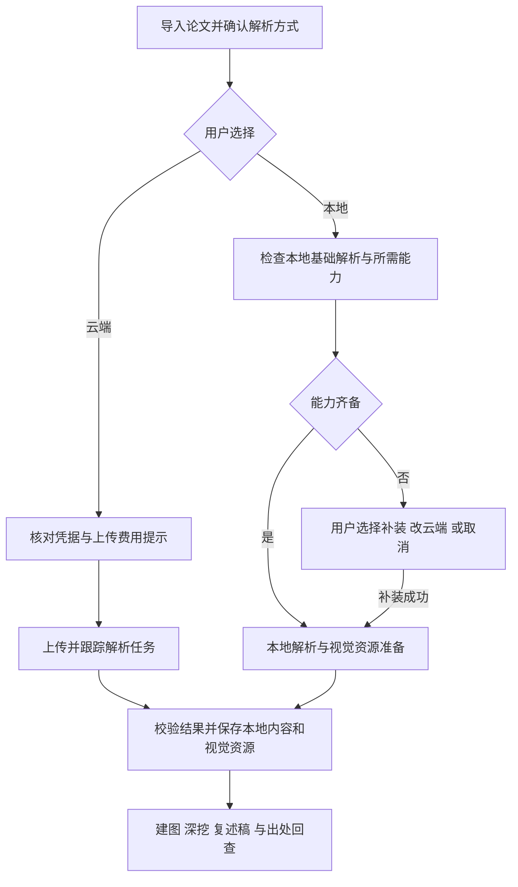

# 可选云端解析与本地组件瘦身 - Plan

## Goal Capsule

- **Objective:** 用户可以选择一家国内云端服务解析论文，或安装更快可用的本地基础解析；扫描页 OCR 和高精表格解析可按需补装，两条路径均能支撑既有精读与证据回查。
- **Product authority:** 本文承接用户确认的 v1.4.0 范围，以 [STRATEGY.md](../../STRATEGY.md)、[CONCEPTS.md](../../CONCEPTS.md) 的论文精读与本地书库语义为基础；云端上传是用户主动选择的新增行为。
- **Open blockers:** 无未决产品范围；云端服务、真实论文质量、组件收益及重解析兼容方式尚需规划和试验核实。
- **Stop condition:** 云端候选无法满足证据契约、本地基础方案没有实测收益，或重解析会使历史出处错绑时，报告证据并调整方案，不以纯文字输出、拆包数量或测试替身代替交付。

---

## Product Contract

### Summary

v1.4.0 交付可选择的云端与本地论文解析。云端首版接入一家经真实论文对照验证的国内服务；本地优先让普通文本论文更快可用，其余解析能力按需安装。解析方式不同，后续建图、深挖、复述稿与出处回查仍使用一致的领域语义。

### Problem Frame

用户反馈侧车组件包过大，同时希望使用国内云端 OCR 或多模态模型作为本地解析的替代方式。当前发行清单记录完整组件 ZIP 为 885,407,140 字节，展开为 1,668,938,420 字节；这只是发布元数据，不是本轮重测结果。

现行组件将嵌入式 Python、运行依赖和基础模型整套交付，普通文本论文也要求全套基础模型就绪。单纯将依赖和模型拆包不保证首次下载更小，因此本地成果以基础路径的实际下载量、占用及首次可用时间衡量。云端成果须覆盖结构化文本和视觉证据，不能只返回 Markdown 而让用户继续安装完整侧车。

### Key Decisions

- **同时交付云端与本地两种方式。** Governs R1, R7, R10. (session-settled: user-directed — chosen over local-only delivery or an experiment-only report: the user requires both usable routes.)
- **云端首版只接入一家通过论文对照的国内服务。** Governs R7, R8. (session-settled: user-directed — chosen over integrating three vendors or generic multimodal endpoints immediately: validate one route before expanding.)
- **用户配置默认方式，导入时可改单篇选择，自行提供凭据并承担服务费用。** Governs R2, R3, R4. (session-settled: user-approved — chosen over automatic routing and shared credentials: preserve user control over upload and cost.)
- **失败由用户选择重试或改用本地。** Governs R5, R6. (session-settled: user-approved — chosen over automatic resubmission or fallback: avoid unexpected upload and repeated billing.)
- **本地优先让普通文本论文更快可用，扩展能力按需补装。** Governs R10, R11, R12. (session-settled: user-directed — chosen over preserving a full initial download or only splitting upgrade packages: improve first use.)
- **切换方式不自动改写存量论文，云端结果完成后可离线查看。** Governs R7, R9, R14. (session-settled: user-approved — chosen over automatic reprocessing or dependence on the full local component: retain existing content and make cloud parsing independently useful.)

### Requirements

**选择、上传与任务**

- R1. 用户可选择云端解析或本地解析组件；两条路径均交付实际可用能力，服务选型试验不能替代其中任一路径。
- R2. 设置中保存默认解析方式，导入 PDF、arXiv 论文及示例论文时可在解析启动前更改单篇选择；未作选择的新用户须先选择，不能因默认值而静默上传。
- R3. 云端解析使用用户自行配置的服务凭据，费用由用户承担；凭据只存本机设置，不进入论文导出、日志或可分享的结果。
- R4. 云端启动前明确告知论文或页面图像将发送到所选服务，并提示可能计费；提醒可随配置确认持续生效，实际发送须与当前单篇选择一致。
- R5. 云端任务显示实际阶段、成功或失败及可理解的原因；失败可由用户重试或明确改用本地，不自动重提可能计费的解析请求或自动切换服务。
- R6. 取消须停止客户端后续提交和结果发布，释放本机任务准入；已经受理的远端任务可能继续执行或计费时如实提示，不能承诺供应商无法保证的撤销。中断后同一已受理任务的状态查询、结果取回与重新提交须区分，避免将查询恢复变成重复付费解析。

**云端结果与阅读契约**

- R7. 云端首版接入一家国内服务，未安装完整本地组件时仍可完成解析与所需视觉资源准备，并进入建图、深挖和出处回查。
- R8. 候选服务使用同一真实论文集与现行本地方案对照，验证章节和阅读顺序、文本完整性、公式与表格数字、图表及标题归属、页完整性，以及 PDF 坐标叠加；通过后才作为正式云端方式。专用 OCR、文档解析和多模态模型均可进入候选，不以接口名称或供应商声明证明质量。
- R9. 云端解析的结构化结果、必要页图和图表资源保存到本地书库，断网后仍可查看已保存内容和出处；供应商临时链接不可作为唯一资源来源。模型生成行为仍需要已配置模型服务，不承诺断网生成。

**本地基础解析与按需能力**

- R10. 本地基础解析须支持带文本层的普通论文，保留布局、章节、图表取证及基础表格解析；首次就绪不强制下载扫描页 OCR 或高精表格解析所需的额外模型。
- R11. 用户需要扫描页 OCR 或主动选择高精表格解析时，明确提示所需能力、待下载量和新增占用，并提供补装、改用云端或取消选择；不得静默下载，不得将缺少所需能力的任务标为完整成功。
- R12. 能力安装须校验内容完整性和解析器兼容性，仅在成功后标记相应能力就绪；失败或取消保留已有可用能力并允许重试。已就绪的常规本地解析可离线执行，其他明确开启的在线增强行为沿用既有提示边界。
- R13. 复用仍兼容的已安装完整组件及能力，避免无必要重下载；支持本地文件离线安装及明确卸载，展示各能力可用状态和磁盘占用，升级或卸载不删除论文及阅读产物。

**存量兼容与收益**

- R14. 更改默认方式只影响后续任务，已解析论文继续使用已有结果；明确发起重解析时才采用所选方式。失败或取消不得破坏旧结果，成功替换须处理依赖旧块地址的阅读产物、问答绑定及出处，不能让旧地址指向新内容；具体失效和用户提示规则在规划前核对现行重解析路径，若需新的破坏性行为则返回对齐。
- R15. 两种方式均遵循现有文本块、图表、页码及可信出处语义；无法核实的区域只能给出页级定位或明确降级，不把模型猜测坐标当成精确命中。
- R16. 按现行完整组件重新测量基线，对比本地基础解析的首次总下载量、最终与峰值磁盘占用、干净环境首次成功解析时间，以及扩展能力全装后的总成本。基础路径须有更少初始下载和更短首次可用时间的实测收益，不能只凭历史估算或把下载推迟到首次解析来宣称瘦身。

### Key Flows

- F1. **Trigger:** 用户首次配置。**Steps:** 选择方式，云端配置凭据并了解上传与费用，本地查看基础解析与可选能力。**Outcome:** 后续导入有明确默认值，单篇仍可修改，满足 R2-R4。
- F2. **Trigger:** 用户选择云端导入。**Steps:** 核对配置，提交后跟踪任务，取回并核实所有所需结果，保存到本机。**Outcome:** 无完整侧车也能阅读和取证，后续不依赖临时链接，满足 R5-R9。
- F3. **Trigger:** 本地解析普通文本论文。**Steps:** 仅安装并校验基础解析，执行解析与视觉资源准备。**Outcome:** 无 OCR 和高精表格扩展也可完成普通论文路径，满足 R10、R12。
- F4. **Trigger:** 扫描页或用户请求高精表格解析而能力缺失。**Steps:** 提示补装需求和成本，由用户选择补装、云端或取消。**Outcome:** 能力和结果状态真实，现有可用能力不受失败影响，满足 R11-R13。
- F5. **Trigger:** 切换默认方式或明确重解析。**Steps:** 按 R14 保留既有结果，核对替换影响，再发布新结果。**Outcome:** 切换不隐式改库，旧出处不误绑新内容。

### Acceptance Examples

- AE1. **Covers R2-R4, R7, R9.** 新安装且未装完整组件的用户选择云端，只有完成配置与上传提示后才发送论文；成功后关闭网络仍能查看原文、图表和出处。
- AE2. **Covers R5, R6.** 云端提交已受理但查询断线，重试查询不再次提交解析；取消后本机任务可结束，若远端无法停止则明确提示可能继续计费。
- AE3. **Covers R10, R16.** 干净环境只安装基础解析，普通文本论文可完成结构化解析和基础表格、图表读取；计时包含所需下载、安装及首次解析，不漏计推迟下载。
- AE4. **Covers R11, R12.** 基础解析遇到扫描页，显示能力缺口；用户取消补装后基础能力仍可用，此篇不能被宣称完整解析成功。
- AE5. **Covers R12, R13.** 能力包损坏、不兼容、下载停流或解压时取消，不能标就绪或替换旧可用能力；同一版本正常重试可恢复，本地文件安装使用相同校验标准。
- AE6. **Covers R14, R15.** 已有本地解析论文切换默认为云端后，旧产物及出处不变；明确重解析失败仍可读旧结果，成功后的旧绑定不得误命中新块。
- AE7. **Covers R8, R15.** 双栏、密集表格、公式、跨页图表和扫描页论文逐项对照；某云端结果只有流畅文字但缺页或数字错误，不能因 Markdown 可显示就通过。

### Scope Boundaries

- 云端首版不同时承诺百度、火山和阿里多家适配，也不承诺任意多模态接口都能用于解析；后续接入须经过同样的证据验证。
- 本次不建立托管账户、共享 API Key、模型代理、云同步或 Android 客户端；论文内容权威来源仍是 Windows 本地书库。
- 本地拆包、依赖裁剪、模型组合及轻量视觉资源生成是待验证手段，不预先锁定包数量、库替换或新本地解析引擎。
- 不改造阅读工作台，不重新设计建图、深挖和复述稿；为解析后端兼容而调整共有契约时保持这些行为。

<!-- nk-section: work-relationships -->
### How This Work Fits Together

本 Plan 覆盖一个完整成果：用户可选择解析方式，两条路径都产出可用于精读的本地内容。云端适配与本地瘦身可分别验证，共享结果、任务和设置契约。

- **以 v1.3.0 正式版复核：** 本分支最初从 `be4dedf` 开始，暂停期间等待的 v1.3.0 已正式发布。2026-10-06 用户决定在主目录恢复 v1.4.0，本分支整合最新 `main`（`477331d`）。须先对照现行 PDF 与原文块映射、文字坐标及侧车实现复核本 Plan，再补全实验和实施安排。
- **共享出处语义：** 本分支已包含 v1.3.0 PDF 证据阅读成果；后续仍须补做云端和本地解析结果的 PDF 回归，已有阅读验收不能代替新增解析路径验收。
- **后续扩展：** 更多云端服务及替代本地后端另行决定，本 Plan 不承诺完整路线图。

### Outstanding Questions

**Deferred to Planning**

- 已选百度 PaddleOCR-VL 作为首个试点；直接文件上传、账号条件、保留与删除、费用和取消边界仍须核实，真实质量待同机对照，不再重复多家选型。
- 云端结果如何转换成现行块模型，以及页图、图表裁切如何在无完整侧车环境生成或取得；核对坐标缩放、旋转、跨页与资源有效期。
- 基础依赖和模型的实际体积构成，OCR 是否共用已有大依赖，fast/accurate 表格模型能否分别就绪，以及新旧组件兼容与离线包格式。
- 在同机现行基线测量后，为 R16 的收益确定具体阈值和重复测量方法；若无法达到更快可用的目标，带数据返回需求讨论。
- 现行重解析、产物失效和问答绑定清理规则；新增路径不得直接复用旧块标识而造成历史内容误绑，无法保持 R14 时先对齐行为。
- 真实云端对照需要可用服务账号、凭据和费用预算；实际调用时取得可用配置，不在需求阶段写入凭据或上传论文。

### v1.3.0 兼容复核（2026-10-06）

Product Contract 未改动。以下补充落实 R5-R16 的技术边界与验收依据，不代表服务已选定或实施方案已补全。复核基点为 `main` 的 `477331d`，本目录在 `codex/v1.4.0` 继续推进；旧并行工作树已删除，需求提交仍保留在分支历史中。

1. **可信来源需要后端验证接线，不能只写入坐标。** `main.js` 的 `loadBlockModel` 读取块模型后先移除 `sourceRegions`，再通过 `pdfmap.getSourceRegions@1` 恢复。现行 `pdfmap_evidence.rs` 仅从 `docling-source.json` 或 Docling 缓存恢复，校验附件完整性、PDF 的 Docling 身份值与去除来源字段后的块模型投影，并在返回前重查 PDF / 块模型摘要。云端适配需提供与原始 PDF 和本次块模型绑定的可验证来源结果，保留现有旧 Docling 恢复路径；不得绕过 Rust 验证来让高亮可见。具体来源附件格式及验证方式留给实施规划，不能把云端坐标伪装成 Docling 输出。对应 R8、R9、R15。

2. **统一几何要写清单位、页尺寸和降级。** 当前 `SourceRegion` 使用 1 起始页码；`bbox` 为左上角原点、scale=2 的 `[x, y, width, height]`，`pageSize` 为 scale=1 的 PDF 页宽高，可选 `charspan` 为块内字符区间。多栏及跨页保留多个区域，不合成覆盖无关内容的大框。前端对页尺寸不匹配、越界或非零旋转不给精确矩形；云端坐标须完成转换和原始 PDF 叠加验证，不能在规划中承诺现行阅读器尚未支持的旋转高亮。对应 R8、R15。

3. **实际选区与解析出处分开兼容。** schema v8 已保存 `pdfSelection`，截图使用 `pdf-selection-*` 附件，支持历史重放与导出导入。`selectionBinding` 只在文字和唯一、连续来源块匹配时给出精确片段绑定；框选或不可靠命中只提供上下文。重解析须分别处理原 PDF 上的实际文字 / 截图、选区中的旧块命中、聊天片段引用和章节绑定；不能因为解析器改变就将实际截图等同于旧块数据删除，也不能让旧 `hits` / `cite` 命中新块。具体保留、失效和用户提示规则仍按 R14 对齐后决定。对应 R9、R14、R15。

4. **PDF 可显示不等于精读视觉资源就绪。** 连续阅读和选区截图已由 PDF.js 渲染，但 Rust 协议所需页图及图表 / 公式裁切仍走 `pdfassets.prerender@1`，需要侧车；`scope=all` 还会重映射 Docling 结果。前端 `ensureBlockModel` / `ensurePrerender` 也依赖本地解析就绪与 `doclingJsonPath`。云端方案必须覆盖这些前置入口、离线视觉附件和齐备性检查；不能只接入解析接口或看到 PDF.js 画面就宣称“无需完整组件”。本地瘦身测量须包含所选视觉资源生成依赖。对应 R7、R9、R10、R16。

5. **重解析需要安全发布边界。** `persist_convert_block_model` 先覆盖 `blockmodel.json`，再写 `docling-source.json`；预渲染附件逐件提交，`scope=all/crops` 还可能覆盖块模型。现有流程不是整套解析结果的原子替换。`papers.applyResplit` 是文本重新切分规则，会保留论文级 map / retell 及聊天，不能直接作为解析器切换的兼容政策。实施规划须先定义候选结果暂存、校验、取消检查、整套发布与旧产物处理，防止块模型、来源、页图和裁切来自不同解析批次；同篇已有建图、深挖或渲染任务时须处理竞争与迟到结果。对应 R6、R12、R14、R15。

6. **复用网络模式与任务准入，按云端提交语义重试。** v1.3.0 已有 Rust 自动代理 / 直连设置，新云端上传、查询与结果下载须遵循当前模式，尚未发送的后续请求重新读取模式，已发送请求沿原模式完成。Python 侧车不在此设置覆盖范围内。复用任务、组件与更新的统一准入边界，能力包下载沿用现有完整性及停流处理；云端计费提交不能直接套用通用网络自动重试，查询恢复与重新提交仍按 R5、R6 分开。新增网络阶段的超时阈值由实施规划确定，不直接把更新下载的阈值视作云端服务契约。对应 R5、R6、R12、R13。

**必须补入实施验证的场景**

| 场景 | 预期与追溯 |
| --- | --- |
| 云端双栏 / 跨页结果；错误 PDF 身份、旧块模型摘要、页尺寸不符、旋转页 | 合法来源经原生桥恢复并叠加；不可信来源保守降级，不猜画高亮。AE7、R15。 |
| 未装完整侧车，云端完成后断网并重开；再次建图或读取图表 | 原文、可信出处、页图及图表附件可用，准备入口不误要求 Docling。AE1、R7、R9。 |
| 本地与云端相互重解析；来源写入 / 裁切下载失败、取消或迟到任务 | 旧结果仍可读，不发布混合批次；成功后旧块引用不误绑新内容。AE6、R14。 |
| 重解析前已有文字选区、截图追问和片段聊天；重开及导出导入 | 实际文字 / 截图与历史问题对象保持一致，旧块绑定按明确兼容规则处理；旧聊天无选区字段仍可读。AE6、R9、R14。 |
| 云端任务已受理后查询断线、切换直连或取消；能力包停流后重试 | 不重复计费提交，后续请求使用当前网络模式，准入释放，已有本地能力不受破坏。AE2、AE5。 |

**复核结论与剩余决定**

两条解析路径与按需能力的产品方向仍适用，无需重做需求。实施规划应先确定共有的来源验证、视觉资源和安全发布契约，再落实云端适配及本地能力组合。服务真实质量、干净环境瘦身收益仍待实验；重解析后历史产物的具体处理尚未敲定，本轮不据此授权清空旧产物。v1.3.0 未更换解析组件，当前基线仍为 `1.2.0-beta.1`，原体积数字与现行清单一致，但不是新实测。

### 百度试点实施单元（2026-10-06）

用户选定百度 PaddleOCR-VL：先对照，效果通过后打通百度完整链路，为后续厂商提供经过验证的结果、来源、视觉资源和任务边界模板。首版不建立多厂商插件框架。本地瘦身仍保留在本 Plan，后续安排以实测为据。

| 单元 | 范围与完成条件 | 需求 |
| --- | --- | --- |
| U1：离线对照准备 | `tools/parser-pilot/`；运行现行组件，保存同机原始结果、身份与耗时；检查百度原始 JSON 并生成原 PDF 叠加图；统计不自动判通过。 | R8、R15；AE7 的准备工作 |
| U2：真实百度对照 | 取得本机凭据、上传及累计预算确认；记录参数与任务 ID，提交不自动重试，查询可恢复；保存真实原始输出并逐项人工评审。先跑 49 页文本层论文，再补扫描、旋转/CropBox、跨页表格专项样本。 | R5、R6、R8、R15；AE2、AE7 |
| U3：百度客户端完整链路 | 仅 U2 验证通过后补全并实施：Rust 上传/查询/下载、设置和单篇选择、可信来源恢复、无完整组件的视觉资源、离线查看、安全替换和历史绑定处理。原生桥、窗口、断网与取消回归必需。 | R1-R9、R14、R15；AE1、AE2、AE6 |

U1 使用 Adam、知识蒸馏、ResNet、XGBoost 现有公开论文夹具，共 49 页；不改 PDF，不把本地结果当成绝对真值。逐篇比对原 PDF 上的页完整性、标题/附录、双栏阅读顺序、关键公式及编号、表格数字与单元格、图表标题归属，以及段落/公式/表格/图形坐标。任何缺页、关键数字错误、系统性错序或错位均阻止 U3；局部降级须列举证据和影响后评估。全部判定保留人工记录，供应商宣传或模拟测试不算通过。

U1 已完成。2026-10-06 用户提供 AI Studio 的 PaddleOCR-VL-1.6 异步 API 示例及试点凭据，U2 改用 AI Studio 入口并实际上传同组 49 页，已完成提交/查询工具、原始结果取回、候选坐标叠加及全页人工核对。U2 尚未通过：确认 6 个局部问题块，可接受的误差与原图回看行为尚待明确，扫描与几何专项仍待完成。U3 的历史产物处理政策、来源附件格式和视觉生成实现仍未定稿；此增补不表示整个 Plan 已进入可执行状态。工具范围与命令见 [试点说明](../../tools/parser-pilot/README.md)。

**U1 同机证据（2026-10-06）**

使用已安装 `1.2.0-beta.1` bundled 组件（Docling 2.126.0），FAST、8 线程、公式增强关闭、独立进程。下列耗时为子进程启动到退出，不含叠加图生成，不是首次下载安装成本或服务端质量评分。

| 论文 | 页数 | 耗时（秒） | 结果 |
| --- | --- | --- | --- |
| Adam `1412.6980` | 15 | 44.69 | `ok:true`，无 warnings |
| 知识蒸馏 `1503.02531` | 9 | 87.53 | `ok:true`，无 warnings |
| ResNet `1512.03385` | 12 | 71.72 | `ok:true`，无 warnings |
| XGBoost `1603.02754` | 13 | 52.60 | `ok:true`，无 warnings |

原始产物和逐篇身份记录保留在本机 `tmp/parser-pilot-20261006/`，共生成 49 张叠加图。人工抽查 Adam 和 ResNet 首页，段落、标题与图形的框可与原 PDF 对照；未逐项完成整组内容质量评审。XGBoost 第 5 页一个文本区域因非法框保守降级，不能把所有框均可生成作为验收目标。百度尚未调用，扫描页、CropBox 与跨页表格专项未验证。

执行嵌入式 Python 的 `tools/parser-pilot/test_pilot.py`，9 项通过，覆盖几何拒绝、两种 Docling 原点、真实 PDF 旋转降级、防覆盖以及转换/检查失败状态；后者仅替代外部子进程边界，不是供应商质量验证。根目录 JavaScript 语法检查通过（137 个文件）。未修改产品代码，未运行 Rust / 桌面集成或 CI。

**U2 首轮结果（2026-10-06）**

试点请求固定 `PaddleOCR-VL-1.6`，通过 AI Studio Access Token 的 bearer 认证。原定百度智能云的 API Key / Secret Key、页价与 `pages[].layouts` 结构不适用于本轮，原格式检查器只保留为离线工具。实际结果通过 `prunedResult.parsing_res_list` 提供 XYXY 框、块内容、顺序及分组；JSONL 分批返回且没有绝对页号，页面对应关系仍需核验。

同组 PDF 身份值及 49 页数量一致，四任务均只提交一次，已取回结果、生成全部 49 页叠加图。简单表格和所查公式/正文具备可用结果，但 ResNet 第 5 页 Table 1 的 HTML 将 `152-layer` 设为跨 3 列，拆出额外数据列，使 `×8 / ×36` 与结构错挂；原 PDF 为 7 列。这触发 R8 / AE7 的质量停止条件，**U2 不判通过，U3 不启动**。候选框可生成不等于来源可信或内容正确。

具体样本、耗时口径、复杂表格、分组多框、页序及剩余检查见 [首轮实测报告](../research/2026-10-06-aistudio-pilot.md)。下一步先验证有证据支持的表格参数或明确视觉降级方案，再完成专项测试；不静默修饰服务输出，不将试验报告替代产品交付。

用户随后要求多个 `gpt-6-luna high` 全量核对，并表示若是偶发可以考虑接受。现有 49 页已逐页检查，确认 6 个局部问题块：两张表的结构/标签、两个附录公式/条件块，以及行内下标与最佳参数强调；未发现整段缺失或系统性栏序错乱。具体证据和统计口径见 [全量复核](../research/2026-10-06-aistudio-full-audit.md)。此次没有重新上传，不能证明随机偶发率；允许哪些局部误差及原图回看行为仍待明确，不能直接把 U2 改判为通过。产品级来源、视觉离线资源及扫描/旋转/CropBox/跨页专项仍未验收。

### Sources / Research

- 本地实现：[组件清单](../../app/src-tauri/component-release.json)、[组件安装](../../app/src-tauri/src/component.rs)、[组件任务](../../app/src-tauri/src/component_runtime.rs)、[侧车门禁](../../app/src-tauri/src/pdfparse.rs)、[块模型映射](../../app/src-tauri/src/pdfmap.rs)、[侧车构建](../../tools/pdfparse-sidecar/build_sidecar.py)、[正式组件打包](../../tools/pdfparse-sidecar/package_component.py)和[侧车说明](../../tools/pdfparse-sidecar/README.md)。正式安装现行仅接受 bundled 整包；现有 download 构建变体不能直接当作新正式方案。
- v1.3.0 复核依据：[来源恢复](../../app/src-tauri/src/pdfmap_evidence.rs)、[前端读取与准备入口](../../app/ui/js/main.js)、[视觉资源落库](../../app/src-tauri/src/pdfassets.rs)、[选区绑定](../../app/ui/js/pdf-selection.js)、[书库校验](../../app/src-tauri/src/library.rs)、[重新切分](../../app/ui/js/papers.js)、[网络任务](../../app/src-tauri/src/net.rs) 与 [更新实现](../../app/src-tauri/src/updater.rs)。复用 [来源与选区契约](../solutions/architecture-patterns/pdf-provenance-and-selection.md) 和 [v1.3.0 发布边界](../releases/v1.3.0.md)，本轮仅核对源码与文档，未运行产品测试、云端调用或组件基准。
- 构想来源：[v2 构想](../ideation/2026-09-24-paper30min-v2-revision.md) 的「解析组件进一步瘦身」「替代解析后端」及试验门槛；整合 v1.3.0 后该文件已在本分支。
- 2026-09-30 核对的官方候选：百度[文档解析](https://ai.baidu.com/ai-doc/OCR/llxst5nn0)描述版面、阅读顺序和坐标；火山[智能文档解析](https://docs.volcengine.com/docs/Largemodelofimagegeneration/Callingmethod-2?lang=zh)描述逐页文本块、类别和坐标；阿里[文档智能大模型版](https://help.aliyun.com/zh/document-mind/developer-reference/document-parsing-large-model-version)描述本地文件上传、异步结果及版面坐标。均未在本轮实际调用。
- 百炼[文档解析提交](https://help.aliyun.com/zh/model-studio/parse/parse-submit)支持请求坐标，但所示接口要求文件 URL；本地 PDF 的上传路径和账号条件仍须验证。[Qwen-OCR](https://help.aliyun.com/zh/model-studio/qwen-vl-ocr)描述专用文档与文字定位任务，是候选而非已选后端。
