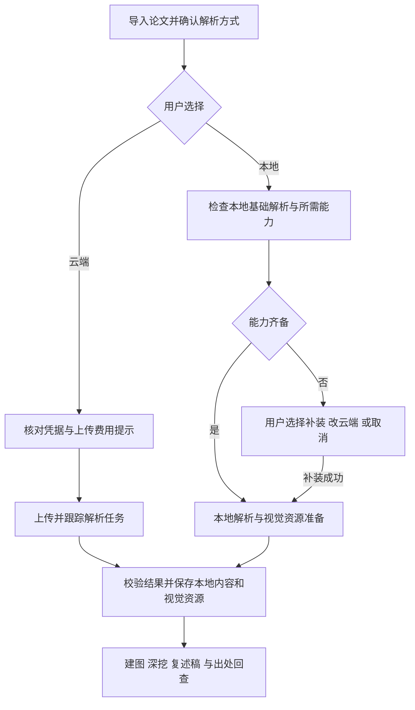

# 可选云端解析与本地组件瘦身 - Plan

## Goal Capsule

- **Objective:** 用户可以选择一家国内云端服务解析论文，或安装更快可用的本地基础解析；扫描页 OCR 和高精表格解析可按需补装，两条路径均能支撑既有精读与证据回查。
- **Product authority:** 本文承接用户确认的 v1.4.0 范围，以 [STRATEGY.md](../../STRATEGY.md)、[CONCEPTS.md](../../CONCEPTS.md) 的论文精读与本地书库语义为基础；云端上传是用户主动选择的新增行为。
- **Open blockers:** 无未决产品范围；云端服务、真实论文质量、组件收益及重解析兼容方式尚需规划和试验核实。
- **Stop condition:** 云端候选无法满足证据契约、本地基础方案没有实测收益，或重解析会使历史出处错绑时，报告证据并调整方案，不以纯文字输出、拆包数量或测试替身代替交付。

---

## Product Contract

### Summary

v1.4.0 交付可选择的云端与本地论文解析。云端首版接入一家经真实论文对照验证的国内服务；本地优先让普通文本论文更快可用，其余解析能力按需安装。解析方式不同，后续建图、深挖、复述稿与出处回查仍使用一致的领域语义。

### Problem Frame

用户反馈侧车组件包过大，同时希望使用国内云端 OCR 或多模态模型作为本地解析的替代方式。当前发行清单记录完整组件 ZIP 为 885,407,140 字节，展开为 1,668,938,420 字节；这只是发布元数据，不是本轮重测结果。

现行组件将嵌入式 Python、运行依赖和基础模型整套交付，普通文本论文也要求全套基础模型就绪。单纯将依赖和模型拆包不保证首次下载更小，因此本地成果以基础路径的实际下载量、占用及首次可用时间衡量。云端成果须覆盖结构化文本和视觉证据，不能只返回 Markdown 而让用户继续安装完整侧车。

### Key Decisions

- **同时交付云端与本地两种方式。** Governs R1, R7, R10. (session-settled: user-directed — chosen over local-only delivery or an experiment-only report: the user requires both usable routes.)
- **云端首版只接入一家通过论文对照的国内服务。** Governs R7, R8. (session-settled: user-directed — chosen over integrating three vendors or generic multimodal endpoints immediately: validate one route before expanding.)
- **用户配置默认方式，导入时可改单篇选择，自行提供凭据并承担服务费用。** Governs R2, R3, R4. (session-settled: user-approved — chosen over automatic routing and shared credentials: preserve user control over upload and cost.)
- **失败由用户选择重试或改用本地。** Governs R5, R6. (session-settled: user-approved — chosen over automatic resubmission or fallback: avoid unexpected upload and repeated billing.)
- **本地优先让普通文本论文更快可用，扩展能力按需补装。** Governs R10, R11, R12. (session-settled: user-directed — chosen over preserving a full initial download or only splitting upgrade packages: improve first use.)
- **切换方式不自动改写存量论文，云端结果完成后可离线查看。** Governs R7, R9, R14. (session-settled: user-approved — chosen over automatic reprocessing or dependence on the full local component: retain existing content and make cloud parsing independently useful.)

### Requirements

**选择、上传与任务**

- R1. 用户可选择云端解析或本地解析组件；两条路径均交付实际可用能力，服务选型试验不能替代其中任一路径。
- R2. 设置中保存默认解析方式，导入 PDF、arXiv 论文及示例论文时可在解析启动前更改单篇选择；未作选择的新用户须先选择，不能因默认值而静默上传。
- R3. 云端解析使用用户自行配置的服务凭据，费用由用户承担；凭据只存本机设置，不进入论文导出、日志或可分享的结果。
- R4. 云端启动前明确告知论文或页面图像将发送到所选服务，并提示可能计费；提醒可随配置确认持续生效，实际发送须与当前单篇选择一致。
- R5. 云端任务显示实际阶段、成功或失败及可理解的原因；失败可由用户重试或明确改用本地，不自动重提可能计费的解析请求或自动切换服务。
- R6. 取消须停止客户端后续提交和结果发布，释放本机任务准入；已经受理的远端任务可能继续执行或计费时如实提示，不能承诺供应商无法保证的撤销。中断后同一已受理任务的状态查询、结果取回与重新提交须区分，避免将查询恢复变成重复付费解析。

**云端结果与阅读契约**

- R7. 云端首版接入一家国内服务，未安装完整本地组件时仍可完成解析与所需视觉资源准备，并进入建图、深挖和出处回查。
- R8. 候选服务使用同一真实论文集与现行本地方案对照，验证章节和阅读顺序、文本完整性、公式与表格数字、图表及标题归属、页完整性，以及 PDF 坐标叠加；通过后才作为正式云端方式。专用 OCR、文档解析和多模态模型均可进入候选，不以接口名称或供应商声明证明质量。
- R9. 云端解析的结构化结果、必要页图和图表资源保存到本地书库，断网后仍可查看已保存内容和出处；供应商临时链接不可作为唯一资源来源。模型生成行为仍需要已配置模型服务，不承诺断网生成。

**本地基础解析与按需能力**

- R10. 本地基础解析须支持带文本层的普通论文，保留布局、章节、图表取证及基础表格解析；首次就绪不强制下载扫描页 OCR 或高精表格解析所需的额外模型。
- R11. 用户需要扫描页 OCR 或主动选择高精表格解析时，明确提示所需能力、待下载量和新增占用，并提供补装、改用云端或取消选择；不得静默下载，不得将缺少所需能力的任务标为完整成功。
- R12. 能力安装须校验内容完整性和解析器兼容性，仅在成功后标记相应能力就绪；失败或取消保留已有可用能力并允许重试。已就绪的常规本地解析可离线执行，其他明确开启的在线增强行为沿用既有提示边界。
- R13. 复用仍兼容的已安装完整组件及能力，避免无必要重下载；支持本地文件离线安装及明确卸载，展示各能力可用状态和磁盘占用，升级或卸载不删除论文及阅读产物。

**存量兼容与收益**

- R14. 更改默认方式只影响后续任务，已解析论文继续使用已有结果；明确发起重解析时才采用所选方式。失败或取消不得破坏旧结果，成功替换须处理依赖旧块地址的阅读产物、问答绑定及出处，不能让旧地址指向新内容；具体失效和用户提示规则在规划前核对现行重解析路径，若需新的破坏性行为则返回对齐。
- R15. 两种方式均遵循现有文本块、图表、页码及可信出处语义；无法核实的区域只能给出页级定位或明确降级，不把模型猜测坐标当成精确命中。
- R16. 按现行完整组件重新测量基线，对比本地基础解析的首次总下载量、最终与峰值磁盘占用、干净环境首次成功解析时间，以及扩展能力全装后的总成本。基础路径须有更少初始下载和更短首次可用时间的实测收益，不能只凭历史估算或把下载推迟到首次解析来宣称瘦身。

### Key Flows

- F1. **Trigger:** 用户首次配置。**Steps:** 选择方式，云端配置凭据并了解上传与费用，本地查看基础解析与可选能力。**Outcome:** 后续导入有明确默认值，单篇仍可修改，满足 R2-R4。
- F2. **Trigger:** 用户选择云端导入。**Steps:** 核对配置，提交后跟踪任务，取回并核实所有所需结果，保存到本机。**Outcome:** 无完整侧车也能阅读和取证，后续不依赖临时链接，满足 R5-R9。
- F3. **Trigger:** 本地解析普通文本论文。**Steps:** 仅安装并校验基础解析，执行解析与视觉资源准备。**Outcome:** 无 OCR 和高精表格扩展也可完成普通论文路径，满足 R10、R12。
- F4. **Trigger:** 扫描页或用户请求高精表格解析而能力缺失。**Steps:** 提示补装需求和成本，由用户选择补装、云端或取消。**Outcome:** 能力和结果状态真实，现有可用能力不受失败影响，满足 R11-R13。
- F5. **Trigger:** 切换默认方式或明确重解析。**Steps:** 按 R14 保留既有结果，核对替换影响，再发布新结果。**Outcome:** 切换不隐式改库，旧出处不误绑新内容。

### Acceptance Examples

- AE1. **Covers R2-R4, R7, R9.** 新安装且未装完整组件的用户选择云端，只有完成配置与上传提示后才发送论文；成功后关闭网络仍能查看原文、图表和出处。
- AE2. **Covers R5, R6.** 云端提交已受理但查询断线，重试查询不再次提交解析；取消后本机任务可结束，若远端无法停止则明确提示可能继续计费。
- AE3. **Covers R10, R16.** 干净环境只安装基础解析，普通文本论文可完成结构化解析和基础表格、图表读取；计时包含所需下载、安装及首次解析，不漏计推迟下载。
- AE4. **Covers R11, R12.** 基础解析遇到扫描页，显示能力缺口；用户取消补装后基础能力仍可用，此篇不能被宣称完整解析成功。
- AE5. **Covers R12, R13.** 能力包损坏、不兼容、下载停流或解压时取消，不能标就绪或替换旧可用能力；同一版本正常重试可恢复，本地文件安装使用相同校验标准。
- AE6. **Covers R14, R15.** 已有本地解析论文切换默认为云端后，旧产物及出处不变；明确重解析失败仍可读旧结果，成功后的旧绑定不得误命中新块。
- AE7. **Covers R8, R15.** 双栏、密集表格、公式、跨页图表和扫描页论文逐项对照；某云端结果只有流畅文字但缺页或数字错误，不能因 Markdown 可显示就通过。

### Scope Boundaries

- 云端首版不同时承诺百度、火山和阿里多家适配，也不承诺任意多模态接口都能用于解析；后续接入须经过同样的证据验证。
- 本次不建立托管账户、共享 API Key、模型代理、云同步或 Android 客户端；论文内容权威来源仍是 Windows 本地书库。
- 本地拆包、依赖裁剪、模型组合及轻量视觉资源生成是待验证手段，不预先锁定包数量、库替换或新本地解析引擎。
- 不改造阅读工作台，不重新设计建图、深挖和复述稿；为解析后端兼容而调整共有契约时保持这些行为。

<!-- nk-section: work-relationships -->
### How This Work Fits Together

本 Plan 覆盖一个完整成果：用户可选择解析方式，两条路径都产出可用于精读的本地内容。云端适配与本地瘦身可分别验证，共享结果、任务和设置契约。

- **可独立于 v1.3.0 推进：** 本分支从 `be4dedf` 开始，用户明确要求不改变 v1.3.0 发布内容；v1.3.0 合入 main 后，v1.4.0 再合入。
- **共享出处语义：** v1.3.0 PDF 证据阅读成果合入后，须补做云端和本地结果的 PDF 回归；本分支不将该成果提前算作已实现。
- **后续扩展：** 更多云端服务及替代本地后端另行决定，本 Plan 不承诺完整路线图。

### Outstanding Questions

**Deferred to Planning**

- 选哪一家国内服务：比较直接文件上传、账号配置负担、数据保留与删除能力、费用、异步取消边界和实际质量；未经调用的能力仍是官方声明。
- 云端结果如何转换成现行块模型，以及页图、图表裁切如何在无完整侧车环境生成或取得；核对坐标缩放、旋转、跨页与资源有效期。
- 基础依赖和模型的实际体积构成，OCR 是否共用已有大依赖，fast/accurate 表格模型能否分别就绪，以及新旧组件兼容与离线包格式。
- 在同机现行基线测量后，为 R16 的收益确定具体阈值和重复测量方法；若无法达到更快可用的目标，带数据返回需求讨论。
- 现行重解析、产物失效和问答绑定清理规则；新增路径不得直接复用旧块标识而造成历史内容误绑，无法保持 R14 时先对齐行为。
- 真实云端对照需要可用服务账号、凭据和费用预算；实际调用时取得可用配置，不在需求阶段写入凭据或上传论文。

### Sources / Research

- 本地实现：[组件清单](../../app/src-tauri/component-release.json)、[组件安装](../../app/src-tauri/src/component.rs)、[组件任务](../../app/src-tauri/src/component_runtime.rs)、[侧车门禁](../../app/src-tauri/src/pdfparse.rs)、[块模型映射](../../app/src-tauri/src/pdfmap.rs)、[侧车构建](../../tools/pdfparse-sidecar/build_sidecar.py)、[正式组件打包](../../tools/pdfparse-sidecar/package_component.py)和[侧车说明](../../tools/pdfparse-sidecar/README.md)。正式安装现行仅接受 bundled 整包；现有 download 构建变体不能直接当作新正式方案。
- 构想来源：`git show 9705c64:docs/ideation/2026-09-24-paper30min-v2-revision.md` 的「解析组件进一步瘦身」「替代解析后端」及试验门槛。该文件在 v1.3.0 分支，当前分支不复制整份构想或冒称路径已在本地。
- 2026-09-30 核对的官方候选：百度[文档解析](https://ai.baidu.com/ai-doc/OCR/llxst5nn0)描述版面、阅读顺序和坐标；火山[智能文档解析](https://docs.volcengine.com/docs/Largemodelofimagegeneration/Callingmethod-2?lang=zh)描述逐页文本块、类别和坐标；阿里[文档智能大模型版](https://help.aliyun.com/zh/document-mind/developer-reference/document-parsing-large-model-version)描述本地文件上传、异步结果及版面坐标。均未在本轮实际调用。
- 百炼[文档解析提交](https://help.aliyun.com/zh/model-studio/parse/parse-submit)支持请求坐标，但所示接口要求文件 URL；本地 PDF 的上传路径和账号条件仍须验证。[Qwen-OCR](https://help.aliyun.com/zh/model-studio/qwen-vl-ocr)描述专用文档与文字定位任务，是候选而非已选后端。
